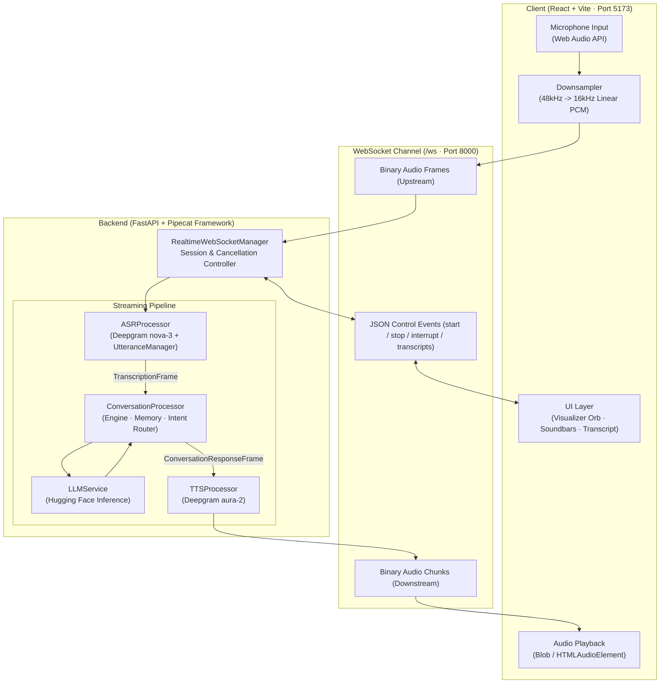
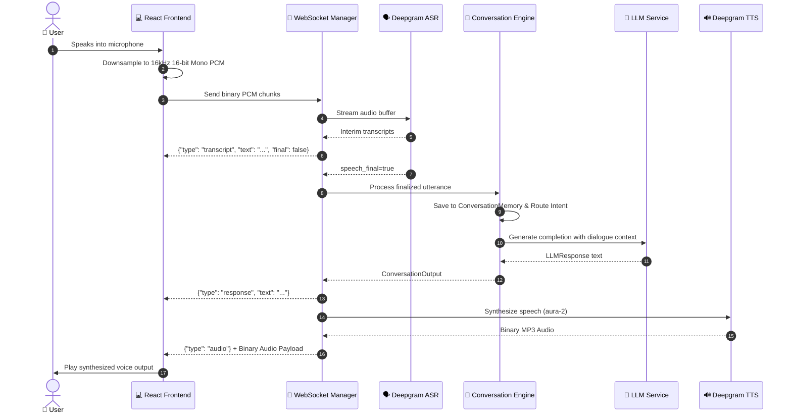

# 🎙️ Real-Time Multimodal Voice Assistant ("Alisha")

A high-performance, full-duplex voice assistant engineered for natural, low-latency conversational AI. The system captures live microphone audio, streams raw PCM frames over WebSockets, performs streaming speech recognition, maintains multi-turn dialogue context with intelligent intent routing, generates LLM completions, synthesizes neural speech, and supports **real-time barge-in / interruption**.

---

## 🌟 Key Features

- **Full-Duplex Real-Time Audio Streaming**: Bi-directional communication over WebSockets using binary linear PCM frames for microsecond-efficient data transport.
- **Streaming Automatic Speech Recognition (ASR)**: Powered by Deepgram `nova-3` with voice activity detection (VAD) and speech endpointing via a dedicated `UtteranceManager`.
- **Conversational Intelligence & Context Memory**:
  - Sliding-window context memory (rolling 50-turn capacity with TTL expiry).
  - Rule-based & heuristic intent classification (`GREETING`, `INFORMATION_REQUEST`, `GENERAL_CONVERSATION`).
  - Modular handler dispatching via `IntentRouter`.
- **Pluggable LLM Reasoning Layer**:
  - Asynchronous execution wrapped in non-blocking workers (`asyncio.to_thread`).
  - Hugging Face Inference API integration with graceful deterministic fallback handling.
- **Neural Text-to-Speech (TTS)**: Deepgram `aura-2-thalia-en` streaming audio synthesis.
- **True Barge-In & Interruption Handling**: Instantly cancels in-flight LLM generation and halts client-side audio playback when user speech is detected or an interrupt command is issued.
- **Extensible Agent Tooling Framework**: Built-in function calling registry (`ToolRegistry`, `ToolExecutor`) with standard math and utility commands.
- **Modern Interactive Frontend**:
  - Built with React 18, TypeScript, and Vite.
  - Custom `useVoiceSession` hook encapsulating Web Audio API recording, client-side downsampling to 16kHz linear PCM, and state management.
  - Interactive glowing visualizer orb, live equalizer soundbars, and real-time transcript stream with partial interim hypotheses.

---

## 🏗️ Architecture Overview



---

## 🔄 End-to-End Conversation Flow



---

## 🛠️ Tech Stack

| Domain | Technology | Description |
|---|---|---|
| **Backend Framework** | [FastAPI](https://fastapi.tiangolo.com/) | Asynchronous, high-performance web API framework |
| **Server** | [Uvicorn](https://www.uvicorn.org/) | Lightning-fast ASGI web server implementation |
| **Pipeline Framework** | [Pipecat AI](https://github.com/pipecat-ai/pipecat) | Frame-based audio/media pipeline orchestration |
| **Speech-to-Text (ASR)**| [Deepgram SDK](https://deepgram.com/) | Real-time WebSocket transcription (`nova-3`) |
| **Language Model** | [Hugging Face Hub](https://huggingface.co/) | Serverless chat inference (`Qwen2.5` / customizable) |
| **Text-to-Speech (TTS)**| [Deepgram Speak](https://deepgram.com/) | Ultra-low latency neural speech synthesis (`aura-2`) |
| **Audio Processing** | `sounddevice`, `numpy`, `pydub` | Hardware I/O, format conversion, and DSP operations |
| **Frontend** | [React 18](https://react.dev/), [TypeScript](https://www.typescriptlang.org/), [Vite](https://vitejs.dev/) | Modern reactive web UI and build tooling |
| **Styling** | Custom CSS3 + `@pipecat-ai/voice-ui-kit` | Dark-mode interface with ambient animations |
| **Testing** | [pytest](https://pytest.org/), AnyIO | Unit and end-to-end integration test suites |

---

## 📁 Project Structure

```text
Voice System/
├── app/
│   ├── agents/                   # Agent function calling & tool execution
│   │   ├── builtin_tools.py      # Calculator, time, and utility tools
│   │   └── tools.py              # BaseTool, ToolRegistry, and ToolExecutor
│   ├── ai/                       # AI service integrations
│   │   ├── asr/                  # ASR abstraction, Deepgram client, utterance manager
│   │   ├── llm/                  # LLM providers (Hugging Face), factory, manager
│   │   └── tts/                  # TTS providers (Deepgram), streaming services
│   ├── api/                      # REST API routing layer
│   │   ├── routers/              # Chat, conversation, and health endpoints
│   │   └── schemas/              # Request and response Pydantic DTOs
│   ├── audio/                    # Hardware audio I/O & DSP utilities
│   │   ├── buffer.py             # Async FIFO queue buffer for audio chunks
│   │   ├── microphone.py         # Hardware microphone stream reader
│   │   └── streaming.py          # Real-time interruptible audio playback
│   ├── conversation/             # Dialogue management & intelligence
│   │   ├── handlers/             # Greeting, Information, and General handlers
│   │   ├── intent/               # Intent classification and routing
│   │   ├── response/             # Response sanitization and building
│   │   ├── engine.py             # Central ConversationEngine coordinator
│   │   └── memory.py             # Rolling dialogue history buffer
│   ├── core/                     # Core cross-cutting infrastructure
│   │   ├── config.py             # Pydantic Settings (.env configuration)
│   │   ├── constants.py          # Enums (audio formats, encodings, events)
│   │   ├── exceptions.py         # Custom domain exception hierarchy
│   │   ├── logging.py            # Console and rotating file logging setup
│   │   └── timers.py             # Performance measurement context managers
│   ├── realtime/                 # WebSocket streaming & pipeline orchestration
│   │   ├── frames/               # Pipecat media pipeline frame definitions
│   │   ├── processors/           # ASR, Conversation, and TTS frame processors
│   │   ├── pipeline.py           # Pipeline worker composition
│   │   ├── signaling.py          # WebRTC SDP signaling (scaffolded)
│   │   ├── transport.py          # WebRTC media transport (scaffolded)
│   │   └── websocket.py          # Core RealtimeWebSocketManager
│   └── server.py                 # FastAPI application and route entry point
├── frontend/                     # React + TypeScript single-page application
│   ├── src/
│   │   ├── App.tsx               # Main voice assistant UI component
│   │   ├── useVoiceSession.ts    # Web Audio capture & WebSocket connection hook
│   │   ├── types.ts              # Connection states & WebSocket message schemas
│   │   ├── styles.css            # Dark theme & visualizer animations
│   │   └── main.tsx              # React DOM entry point
│   ├── package.json              # Frontend dependencies and build scripts
│   └── vite.config.ts            # Vite dev server & /ws proxy configuration
├── tests/                        # 36 comprehensive test suites
│   ├── integration/              # Real-time streaming integration tests
│   └── conftest.py               # AnyIO asyncio fixtures
├── main.py                       # CLI entry point to launch server
├── requirements.txt              # Python project dependencies
└── .env                          # Local environment variables
```

---

## 📐 Design Patterns Applied

- **Strategy Pattern**: Abstract base classes (`BaseASR`, `BaseLLM`, `BaseTTS`, `BaseAudioOutput`) isolate implementation details from consumer services. Swapping providers requires no changes to business logic.
- **Factory Pattern**: Centralized factories (`create_llm()`, `create_tts()`) resolve concrete implementations via configuration variables.
- **Mediator & Orchestrator Pattern**: `ConversationEngine` and `RealtimeWebSocketManager` coordinate multi-stage async handoffs across components.
- **Pipeline & Filter Pattern**: Pipecat frame processors chain discrete transformation stages (`Raw Audio Frame` $\to$ `Transcription Frame` $\to$ `Conversation Response Frame` $\to$ `Output Audio Frame`).
- **Command & Registry Pattern**: Extensible agent tools registered in `ToolRegistry` and executed uniformly via `ToolExecutor`.
- **Producer-Consumer Pattern**: Asynchronous FIFO queues buffer continuous PCM streaming to decouple hardware sampling rates from network transmission.

---

## 🚀 Getting Started

### Prerequisites

- **Python 3.10+**
- **Node.js 18+** & `npm`
- Deepgram API key ([Get one here](https://console.deepgram.com/))
- Hugging Face Access Token ([Get one here](https://huggingface.co/settings/tokens))

### 1. Backend Setup

```bash
# Clone the repository
git clone https://github.com/Sahil9205/realtime-multimodal-system.git
cd "realtime-multimodal-system"

# Create and activate a Python virtual environment
python -m venv venv
# On Windows:
.\venv\Scripts\activate
# On macOS/Linux:
source venv/bin/activate

# Install dependencies
pip install -r requirements.txt
```

### 2. Configure Environment Variables

Create or update the `.env` file in the project root:

```env
# API Keys
DEEPGRAM_API_KEY=your_deepgram_api_key_here
DEEPGRAM_TTS_API_KEY=your_deepgram_tts_key_here
HF_TOKEN=your_huggingface_token_here

# LLM Configuration
LLM_PROVIDER=huggingface
LLM_MODEL=Qwen/Qwen2.5-7B-Instruct

# Audio Settings
SAMPLE_RATE=16000
CHANNELS=1
CHUNK_SIZE=1024

# Logging
LOG_LEVEL=INFO
```

### 3. Frontend Setup

```bash
cd frontend
npm install
cd ..
```

---

## 🏃 Running the Application

### 1. Launch the Backend Server

```bash
# From the project root with venv activated
python main.py
```
The FastAPI server will start at `http://localhost:8000`.

### 2. Launch the Frontend Development Server

Open a second terminal window:

```bash
cd frontend
npm run dev
```
The Vite development server will start at `http://localhost:5173`. Open your browser and navigate to `http://localhost:5173`.

---

## 📡 WebSocket Protocol Reference

All real-time communication between client and server occurs over `ws://localhost:8000/ws`.

### Client $\to$ Server Messages

| Message | Type | Payload Example | Description |
|---|---|---|---|
| **Audio Stream** | Binary (`ArrayBuffer`) | Raw 16-bit Linear PCM (16kHz, mono) | Continuous microphone audio chunks |
| **Start Session** | JSON | `{"type": "start"}` | Initializes server-side pipeline workers |
| **Interrupt** | JSON | `{"type": "interrupt"}` | Immediately halts TTS playback and cancels active LLM generation |
| **Stop Stream** | JSON | `{"type": "stop"}` | Signals end of user speech session |

### Server $\to$ Client Messages

| Message | Type | Payload Example | Description |
|---|---|---|---|
| **Ready** | JSON | `{"type": "ready"}` | Pipeline is initialized and listening |
| **Transcript**| JSON | `{"type": "transcript", "text": "Hello", "final": false}` | Interim or finalized speech transcription |
| **Response** | JSON | `{"type": "response", "text": "Hi there! How can I help?"}` | Synthesized assistant textual response |
| **Audio Header**| JSON | `{"type": "audio", "sample_rate": 16000, "channels": 1, "encoding": "audio/mpeg"}` | Precedes binary audio data |
| **Audio Payload**| Binary (`bytes`) | MP3 audio bytes | Synthesized speech ready for playback |

---

## 🧪 Testing

Run the test suite using `pytest`:

```bash
# Run unit and core pipeline tests
pytest tests/ -v --ignore=tests/integration

# Run integration tests (requires active hardware microphone & API keys)
pytest tests/integration/ -v
```

---

## 📄 License

Distributed under the MIT License. See `LICENSE` for details.
